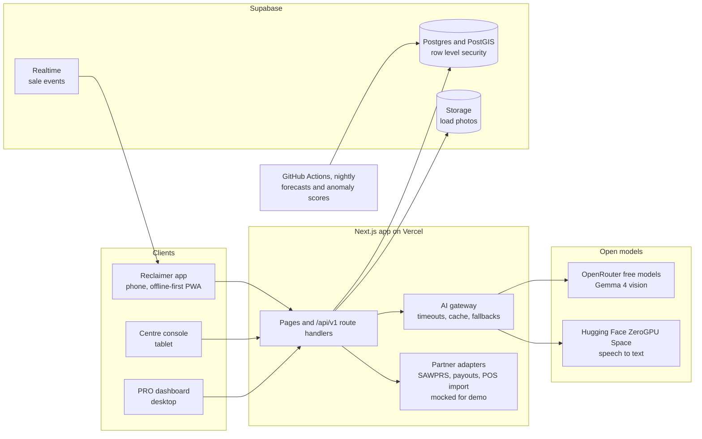
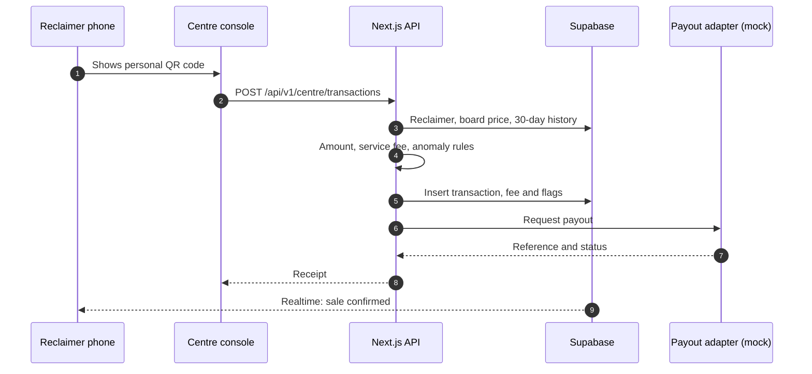

# Architecture

## Overview

One Next.js application serves three views: the reclaimer phone app, the buy-back centre console and the PRO dashboard. The browser never calls a model or a partner directly. All of that goes through server code, so keys stay on the server and every call can time out into a fallback.



## Components

| Component | Technology | Notes |
|---|---|---|
| Reclaimer app | Next.js App Router PWA, Tailwind CSS 4, Atkinson Hyperlegible and Bricolage Grotesque fonts | Installs from a link. Offline support is planned with a service worker |
| Centre console | Same app, tablet layout | QR scan with the browser BarcodeDetector API, ZXing fallback planned |
| PRO dashboard | Same app, desktop layout | Aggregates only. No names or individual sales |
| API | Next.js route handlers under `/api/v1`, zod validation | Errors share one JSON shape |
| Database | Supabase Postgres with PostGIS | Nearest-centre queries, row level security on every table |
| Files | Supabase Storage, private bucket | Photos resized on the phone; signed URLs |
| Live updates | Supabase Realtime on `transactions` | Planned: the reclaimer sees a sale the moment the centre confirms it |
| AI gateway | Server module | Timeouts, model fallback list and result cache. See [MODELS.md](MODELS.md) |
| Nightly jobs | GitHub Actions, Python | Forecasts and batch anomaly scores, written to Postgres |
| Hosting | Vercel for the app, Supabase for data | Not yet deployed |

## Sell flow

The moment a centre weighs a load is where the product's numbers are created: the reclaimer's pay, the service fee, the PRO's tonnage and the anomaly checks.



Rules that apply to every sale:

- The request carries an `Idempotency-Key`. Repeating the key returns the original receipt instead of creating a second sale.
- The amount is calculated in integer cents as `weight_g * cents_per_kg / 1000`, which is generated by the database.
- A sale is never blocked by an anomaly flag. Flags go to the PRO review queue.
- `record_sale()` writes the sale, its service fee, any anomaly row and the audit row in one database transaction. The same key with the same body returns the original sale. The same key with a different body is refused.
- Rule flags: weight over three times the reclaimer's 30-day 95th percentile (needs five earlier sales), a photo within Hamming distance 6 of a load from the last 30 days, and a first sale at a centre outside the reclaimer's home area.

## Data model

Money is stored in integer cents and weight in integer grams.

| Table | Purpose |
|---|---|
| `profiles` | One row per user, with role (`reclaimer`, `operator` or `pro`), language and avatar |
| `materials` | Material codes and their colour tokens |
| `centres` | Buy-back centres with a PostGIS point, hours and operator |
| `reclaimers` | Reclaimer details: area, QR token, consent time and mock SAWPRS reference |
| `prices` | Price history per centre and material |
| `loads` | Load photos with a 64-bit perceptual hash for duplicate detection |
| `transactions` | Weighed sales. The amount column is generated |
| `service_fees` | Fee owed per sale, with status `owed`, `paid` or `missing` |
| `payouts` | Payout records and references |
| `anomalies` | Flags raised by rules or models, with a review status |
| `forecasts` | Nightly price forecasts (p10, p50, p90) per material and area |
| `audit_log` | Server-side audit trail. Readable only by the service role |

Helper functions:

- `current_app_role()` returns the role of the signed-in user. It runs as security definer so policies do not recurse.
- `operates_centre(centre_id)` checks that the signed-in user runs that centre.
- `pro_material_summary(from_date, to_date)` returns aggregates by material and area for PRO users only.

## Row level security

| Table | Reclaimer | Operator | PRO |
|---|---|---|---|
| `profiles` | Own row | Own row | Own row |
| `materials`, `centres`, `prices`, `forecasts` | Read | Read; write prices for own centre | Read |
| `reclaimers` | Own row | No access | No access |
| `loads`, `payouts` | Own rows | No access | No access |
| `transactions`, `service_fees` | Own sales | Sales at own centre | No access |
| `anomalies` | No access | No access | Read and update |
| `audit_log` | No access | No access | No access |

Sales are written only by the server using the service role, after it checks the session and the operator's centre.

Board prices are public information, so the reclaimer screens read them through `board_prices()`, which is granted to `anon` and `authenticated`. The function is security definer and returns only the centre name, area, material, price and time. The `prices` table itself still needs sign-in, and an anonymous client cannot read it directly.

## API contracts

Every request carries the Supabase session as `Authorization: Bearer <jwt>`. Retried writes carry an `Idempotency-Key`. Errors use one shape:

```json
{ "error": { "code": "VALIDATION_FAILED", "message": "weight_g must be between 1 and 500000", "details": { "field": "weight_g" } } }
```

| Status | Meaning |
|---|---|
| 401 | No or expired session |
| 403 | Wrong role, or not the operator's centre |
| 404 | Unknown QR code or record |
| 409 | Idempotency key reused with a different body |
| 422 | Validation failed |
| 429 | Rate limit reached, with `Retry-After` |
| 501 | Not yet connected (current state of the sales route) |
| 503 | A partner adapter is down. The sale is stored and the payout retried |

### Implemented

| Method | Path | State |
|---|---|---|
| GET | `/api/health` | Returns `ok`. Database check planned |
| RPC | `board_prices()` | Latest price per centre and material. Readable without signing in. Returns the centre name and area only, never the operator id |
| POST | `/api/v1/centre/transactions` | Records a weighed sale. Checks the Idempotency-Key, the operator's session, the centre and the board price first. Returns 501 until the service role key is set |

### Planned

| Method | Path | Role | Purpose |
|---|---|---|---|
| GET | `/api/v1/me` | any | Profile, role and registration status |
| GET | `/api/v1/centres/nearby` | reclaimer | Centres with today's price and distance |
| GET | `/api/v1/recommendations` | reclaimer | Best centre and sell-or-wait decision |
| POST | `/api/v1/loads` | reclaimer | Photo upload, material suggestion and duplicate check |
| GET | `/api/v1/earnings` | reclaimer | Totals by material and month |
| GET | `/api/v1/service-fees` | reclaimer | Fee tracker |
| POST | `/api/v1/registration` | reclaimer | Guided SAWPRS registration (mock) |
| GET | `/api/v1/centre/reclaimers/{qr_token}` | operator | Resolve a scanned code |
| PUT | `/api/v1/centre/prices` | operator | Update the price board |
| GET | `/api/v1/pro/summary` | pro | Aggregates |
| GET | `/api/v1/pro/anomalies` | pro | Review queue |
| PATCH | `/api/v1/pro/anomalies/{id}` | pro | Clear or confirm a flag |
| GET | `/api/v1/pro/export.csv` | pro | EPR reporting export |

## Security and privacy

- Row level security on every table. Reclaimers see only their own rows. PROs see aggregates with no names.
- No South African ID numbers in the demo. Registration stores a mock SAWPRS reference and a consent time.
- Photos are in a private bucket, served through short-lived signed URLs, and deleted after 90 days.
- Model and partner keys live in Vercel and GitHub secrets only. The browser never calls a model directly.
- Rate limits on photo uploads and assistant calls, stored in Postgres.
- POPIA-aligned: data is minimised, consent is recorded, and access is limited by role.

## Environments

| Environment | Where | Data |
|---|---|---|
| Local | `npm run dev` on the developer's machine | Demo seed |
| Demo | Vercel preview and Supabase project | Demo seed, reset by script before judging |
| Production | Not yet defined | Not yet defined |

## Known gaps

- Demo auth users are not created yet, so role checks have not been run with real sign-ins.
- The sales route does not store data yet.
- Authentication and demo accounts are not created.
- Payouts and SAWPRS registration are mocks.
- Offline support, the service worker and realtime updates are not built.
