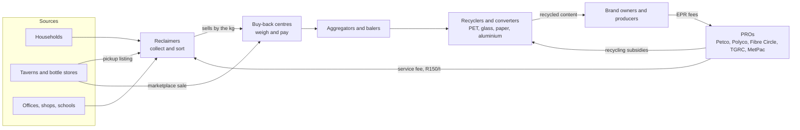

# Business model

How ComeCollectZA makes money without taking money from reclaimers, who is in the value chain, and how users are verified. Written 23 Oct 2026. Every number marked as an assumption still needs to be checked with a PRO, a buy-back centre and a business seller.

## The rule we do not break

**Reclaimers never pay.** The reclaimer always gets the full board price and the full service fee. Every rand of revenue comes from the businesses that gain from verified, traceable material: producers and their PROs, buy-back centres, aggregators and business buyers.

## Value chain

ComeCollectZA sits on the arrows. It records each kilogram where it changes hands (reclaimer to centre, tavern to reclaimer or buyer), so the PROs can see what was collected, where, by whom, and whether the service fee was paid.

### Where taverns and bottle stores fit

Taverns, shebeens and bottle stores produce steady volumes of cans, one-way glass, PET and cardboard in places where reclaimers already work. Returnable bottles keep going back through the brewer's own deposit system, so the app handles only non-returnable packaging.

- **Pickup listing (free for the business):** the owner scans the pile with the same on-device scanner, posts "about 60 kg of cans and cardboard, ready after 10:00", and a nearby verified reclaimer claims it. The business gets free removal; the reclaimer gets a reliable, sorted load.
- **Direct sale (for larger outlets):** a bottle store with a full cage can sell straight to a centre or aggregator on the marketplace at a posted price per tonne.
- **Handshake:** pickups are confirmed by scanning each other's QR codes, which gives both sides a record and feeds the trust score.

## Revenue streams

| Stream | Who pays | Price (assumption) | Why they pay |
|---|---|---|---|
| **1. Verified collection data** | PROs and producers | R50 per verified tonne reported | They must prove collection and pay service fees under EPR. Our records come from the weigh-in, with material, area, centre and time, and the on-device scan as a second check. R50 is 6.5% of Petco's 2026 PET EPR fee of R773/t |
| **2. Transaction fee on recorded sales** | The buyer (centre, aggregator or business buyer), never the seller | 2% of sale value | Digital receipts, instant payout rails, price board, anomaly checks and records for audits. The reclaimer's price is not reduced |
| **3. Marketplace fee on business trades** | Buyer of a business-to-business lot (tavern or bottle store to centre or aggregator) | 3% of trade value | Matching, pickup handshake, proof of origin |
| **4. Payout rails** | Payment partner | Share of transaction revenue | Reclaimers paid to an eWallet instead of cash. A bank partner gains thousands of new account holders |
| **5. Market insight reports** | Recyclers, converters, municipalities | R5 000 to R20 000 a report | Anonymous, aggregated flows: tonnes by material and area, price trends. Never personal data |

Streams 1 and 2 are the core. Stream 1 sells the scanned and weighed data. Stream 2 is the share of each sale.

## Unit economics per active reclaimer (assumptions)

| Item | Value | Basis |
|---|---|---|
| Material sold per working day | 100 kg | Reported range 80 to 400 kg a day (Sunday Times, Sep 2026). We use the low end |
| Average price | R2.50/kg | Mix of PET, cardboard, cans and glass at the 2026 ranges in [lib/market-prices.ts](../lib/market-prices.ts) |
| Working days a month | 22 | |
| Tonnes a month | 2.2 t | |
| Sales a month | R5 500 | Paid in full to the reclaimer |
| Service fee a month | R330 | 15c/kg, paid in full to the reclaimer |
| **Revenue: data fee** | R110 | 2.2 t at R50/t |
| **Revenue: 2% buyer-paid fee** | R110 | 2% of R5 500 |
| **Revenue per reclaimer a month** | **R220** | |
| Cost per reclaimer a month | about R10 | Hosting, SMS one-time PINs and storage. The scanner runs on the phone, so there is no model cost |

At 1 000 active reclaimers that is about R220 000 a month. The Sunday Times reports at least 15 000 waste pickers registered for EPR in Gauteng and KwaZulu-Natal alone.

### What has to be true

- A PRO will pay for weigh-in records it can audit. Test this with one PRO before building more.
- Centres accept a 2% fee because the app saves them cash handling and record keeping. If not, the fee moves fully to the PRO side.
- Reclaimers keep using the app because it shows the best price, proves their work and makes the service fee visible. This needs testing with real reclaimers.

## Trust and verification

Users must be real and trusted before money or data moves. Verification is stepped, so a reclaimer can start with only a phone.

| Level | Who | How | Unlocks |
|---|---|---|---|
| 0. Phone | Everyone | One-time PIN by SMS (Supabase phone sign-in). One account per number | Prices, scanner, own records |
| 1. Seen in person | Reclaimers | A centre operator scans the reclaimer's code at a weigh-in and confirms the face matches the profile photo (taken with consent). SAWPRS reference recorded | Receipts that count for the service fee and the PRO data feed |
| 2. Business | Taverns, bottle stores, buyers | CIPC registration or liquor licence number, address pin, and a first pickup confirmed by a level 1 reclaimer | Pickup listings, marketplace sales |
| Ongoing | Everyone | Two-sided QR handshake on pickups, ratings after each pickup, anomaly rules on weights and duplicate photos, server-side audit log | Trust score shown to the other side |

What is built today: email accounts with reclaimer and business roles, one code per reclaimer, operator checks in the sales route, anomaly rules in `record_sale()`, the audit log, and marketplace posts. Phone sign-in, profile photos, business document checks, ratings and a way to contact a poster are not built.

POPIA: collect the minimum (phone, area, age band, photo with consent), never sell personal data, and share only aggregates with PROs and buyers.

## Low connectivity

- The scanner runs on the phone and works with no data after a one-time 38 MB download. Photos are never uploaded.
- The reclaimer's main pages are saved on the phone and open offline with the last prices.
- Planned: queue sales and pickup claims offline and send them when a signal returns. Use SMS fallback for pickup alerts.

## Lean Canvas (for the Sonke submission)

| Box | Answer |
|---|---|
| **Problem** | 1. Reclaimers do not know which centre pays best today and lose money. 2. Their work is invisible, so the EPR service fee (15c/kg) goes unpaid. 3. PROs cannot prove where collected tonnes came from. Existing alternatives: cash at the nearest centre, paper slips, PRO spreadsheets |
| **Customer segments** | Users: reclaimers (waste pickers), tavern and bottle store owners. Paying customers: PROs and producers, buy-back centres, aggregators. Early adopters: reclaimers already registered on SAWPRS in Gauteng and KZN, and one PRO running service-fee payments |
| **Unique value proposition** | Get paid fairly for every kilogram, and get credit for it |
| **Solution** | Live price board and best-centre advice; an on-device scanner that names the material, even in mixed loads, with no data; QR receipts at the weigh-in; service-fee tracker; pickup listings for taverns and bottle stores |
| **Channels** | Buy-back centres (onboard reclaimers at the scale), reclaimer organisations (African Reclaimers Organisation, SA Waste Pickers Association), PRO programmes, tavern associations, WhatsApp share links |
| **Revenue streams** | R50 per verified tonne from PROs and producers; 2% buyer-paid transaction fee; 3% marketplace fee on business trades; payout partner share; insight reports |
| **Cost structure** | Hosting and database (free tiers at pilot scale), SMS PINs, field onboarding at centres, support, team |
| **Key metrics** | Active reclaimers a week; tonnes recorded by material; share of sales with a verified receipt; service fees paid against owed; reclaimer income per month; CO2e avoided; youth share of active reclaimers |
| **Unfair advantage** | Reclaimer-first trust and data recorded at the weigh-in, built to plug into SAWPRS and PRO systems instead of competing with them; on-device AI that works without data |

## Sources

- Petco EPR fees 2026: https://petco.co.za/producers/epr-fees/
- Sunday Times, "From your bin to cash", 21 Sep 2026: https://www.sundaytimes.timeslive.co.za/news/2026-09-21-from-your-bin-to-cash-the-hidden-economy-of-waste-picking/
- GroundUp on the 15c/kg service fee: https://groundup.org.za/article/packaging-companies-fall-foul-of-required-waste-picker-payments/
- Price ranges: [lib/market-prices.ts](../lib/market-prices.ts)
